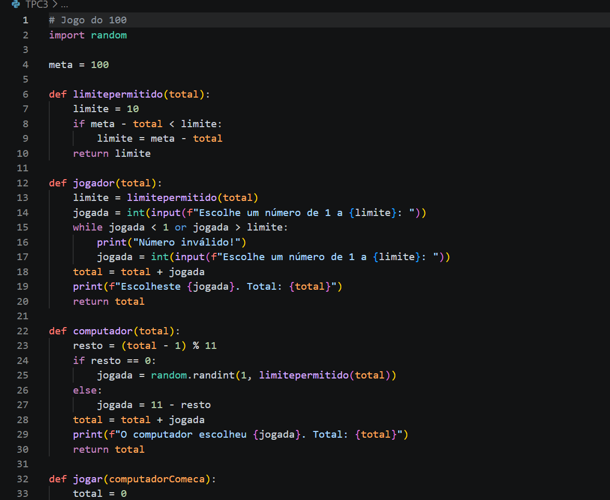
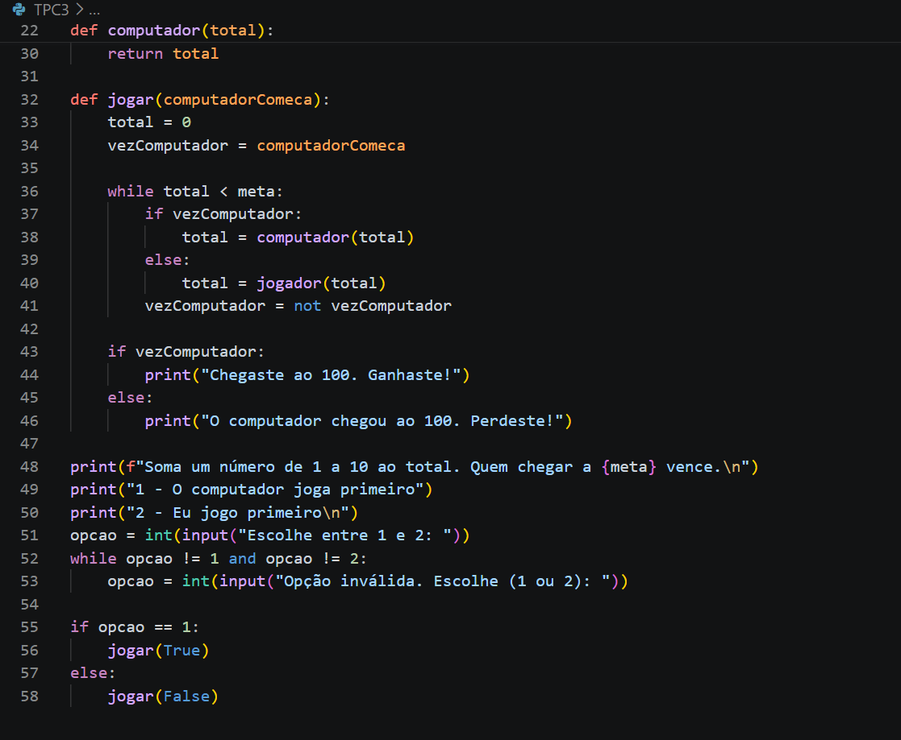
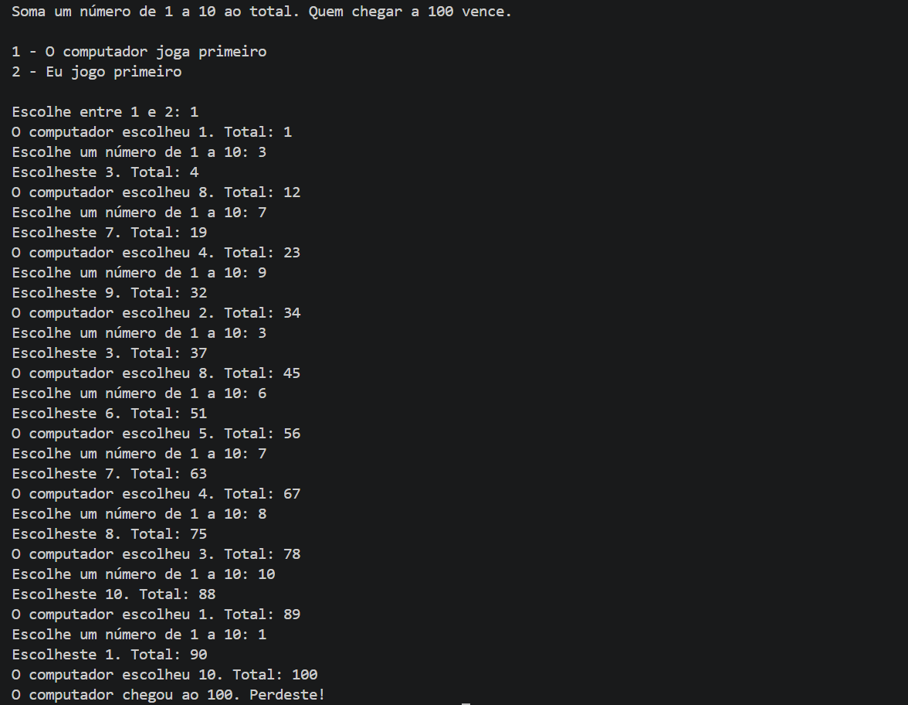

# ATP2026
## Autor
- Cristiana Barreto 
- a115292
- 

# Resumo 
- Programei um jogo com um ciclo "while" que alterna entre o jogador e o computador até o total da soma dos números escolhidos chegar a 100. Para o computador ganhar quando joga primeiro, usei o facto de 100 ter resto 1 na divisão por 11. Em cada jogada ele soma "11 - resto", onde "resto = (total - 1) % 11", para ficar sempre num número com resto 1 (1, 12, 23, ..., 100). Quando joga em segundo, só ganha se o jogador falhar nas escolhas de número.

